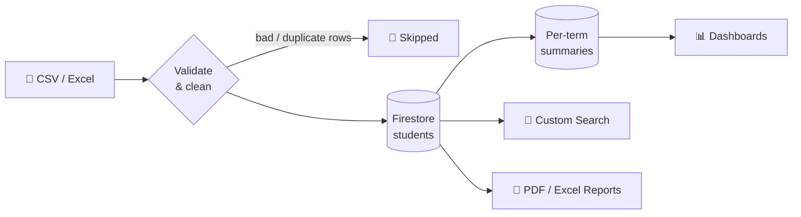

<p align="center">
  
</p>

---

### 🔐 `users/jhsapio`

My system stores every user as a Firestore doc, so here's mine:

```js
{
  name: 'John Hero Sapio',
  age: 22,
  campus: 'MSU Main Campus',
  role: 'developer',
  isActive: true,
  pendingApproval: false,
  currentlyBuilding: 'SDVS — MSU Student Data Visualization System',
  permissions: ['uploadData', 'viewDashboards', 'shipFeatures'],
  favoriteBug: 'the one where the charts and the lists disagreed'
}
```

### 🧭 What I'm building

**SDVS** takes the registrar's raw student files and turns them into something people can actually read: role-based dashboards, filters, and reports for Admins, Registrar Staff, Faculty, Policy Makers, and ICTC.



### 📜 Activity log

Every action in my system gets logged, so here's mine:

| Action           | Detail                                                                 |
| ---------------- | ---------------------------------------------------------------------- |
| `project.start`  | Started SDVS as our capstone project                                   |
| `feature.ship`   | Role-based access with 5 roles and an admin approval flow              |
| `feature.ship`   | CSV/Excel upload with validation, duplicate checks, and upload drafts  |
| `feature.ship`   | Dashboards by college, gender, year level, age, grades, and address    |
| `feature.ship`   | PDF and Excel report generation                                        |
| `status.current` | Polishing, testing, and getting ready for the defense                  |

### 🧰 Stack

| Layer          | Tools                                                                                                                                                                                                                                        |
| -------------- | -------------------------------------------------------------------------------------------------------------------------------------------------------------------------------------------------------------------------------------------- |
| Frontend       |                                                                                                                                                            |
| Framework      |    |
| Backend & Data |                                                                                                                                                                      |
| Charts & Docs  |    |
| Tools          |                                                                                                                                                               |

### 📈 Stats

<p align="center">
  
</p>

<p align="center">
  
  <a href="https://github.com/jhsapio?tab=repositories"></a>
</p>


